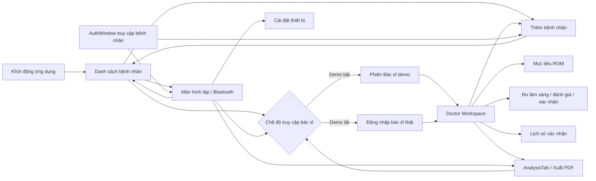

# Liên kết cửa sổ hiện tại

Các đường điều hướng dưới đây đã có trong mã nguồn cục bộ. Đây là kiểm tra mã và biên dịch tham chiếu, chưa phải kiểm tra click trên Windows cho giao diện mới.

- Startup hiện tại: `App.xaml` → `PatientSelectionWindow`.
- Nút Bác sĩ / ROM truyền ID bệnh nhân được chọn. Chế độ demo mặc định mở phiên Bác sĩ demo đã đánh dấu; khi tắt demo thì qua DoctorLoginWindow trước khi mở workspace.
- MainWindow mở workspace theo bệnh nhân đang tập, giữ nguyên xử lý serial/timer/queue.
- Workspace dùng `patientId` riêng và truyền nó vào `AnalysisTab(patientId, doctor)`; ID bác sĩ không dùng `GlobalData.CurrentUserId`.
- Các trang trong workspace dùng `ShowModule`, không tạo ứng dụng hoặc bản lưu dữ liệu khác nhau.
- Nút Lưu xác nhận ở dashboard và checkbox chi tiết dùng chung danh sách mốc, transaction và audit. Chế độ thật xác thực lại khi lưu; demo dùng tài khoản SQL riêng và ghi dấu `[DEMO]`.
- AuthWindow là luồng truy cập bệnh nhân, không phải màn hình đăng nhập bác sĩ. Form mới cho nhập MSBN, chọn từ danh sách hoặc thêm hồ sơ; tạo xong chuyển tới danh sách để chọn bệnh nhân rõ ràng.

Xem [bản cập nhật SQL Server](DOCTOR_WORKSPACE_SQL_SERVER_UPDATE.md) để biết cấu hình, migration và giới hạn kiểm thử mới nhất. Các thay đổi vẫn ở workspace, chưa push lên GitHub.
